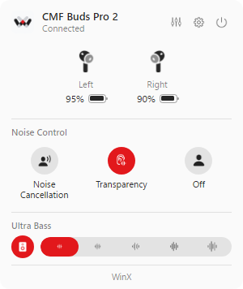
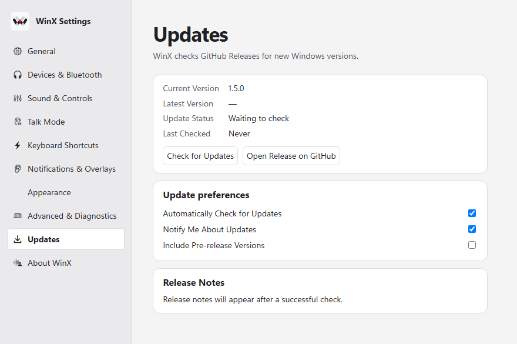
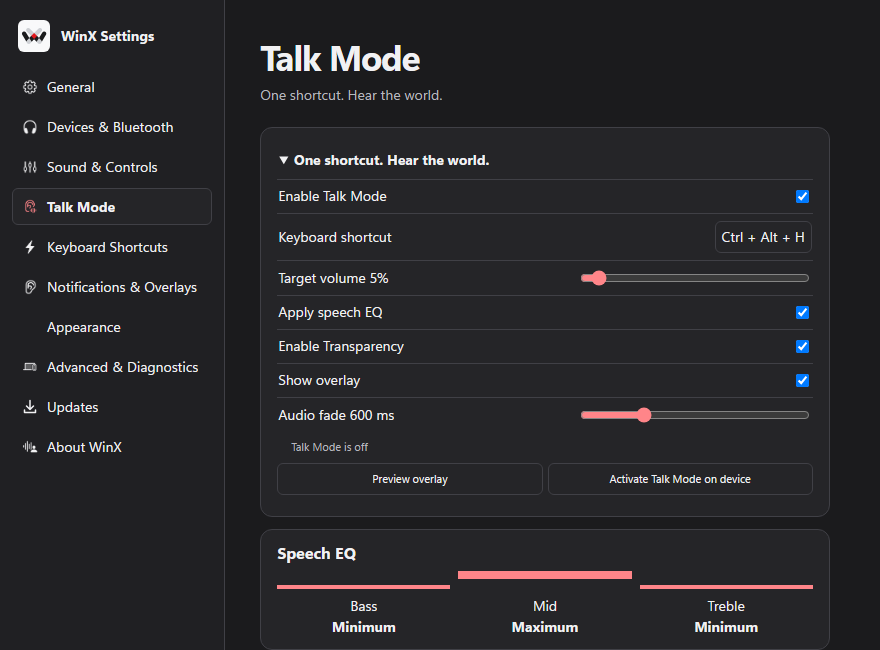
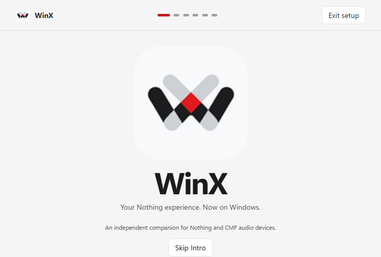
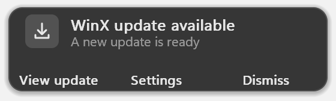

<p align="center">
  
</p>

<h1 align="center">WinX</h1>
<p align="center"><strong>Your Nothing experience. Now on Windows.</strong></p>
<p align="center">
  <a href="https://github.com/Threalcocoboy/WinX/releases/latest"></a>
  <a href="#installation"></a>
  <a href="LICENSE"></a>
  <a href="https://github.com/Threalcocoboy/WinX/actions/workflows/ci.yml"></a>
  <a href="Cargo.toml"></a>
</p>

WinX is an independent Windows companion application for Nothing and CMF audio devices. It puts battery levels, noise controls, and settings in the Windows notification area. Developed and maintained by **Threalcocoboy**.

## Features

| | What WinX can do |
| --- | --- |
| **Device controls** | Read the battery levels a device reports. Switch between noise cancellation, Transparency, and Off. Adjust supported EQ presets and bands, bass enhancement, and low latency. Compatible models can also expose in-ear detection, gestures, dual connection, spatial audio, and Find controls. |
| **Windows integration** | Open controls from the notification area, keep WinX running in the background, and start it with Windows if you choose. Configure global hotkeys and use a separate Settings window. WinX monitors the Bluetooth link and the earbud control session. |
| **Talk Mode** | Use one shortcut to make room for a conversation and use it again to restore your listening settings. |
| **Notifications and overlays** | Show connection and battery alerts and confirmed changes from supported earbud controls. Playback and volume overlays require an identifiable hardware command and a matching playback or volume change. |
| **Onboarding and updates** | Pair and select a device, preview overlays, and learn Talk Mode in the first-run tour. Check for releases, read release notes, and verify an update before opening Setup. |

## Screenshots

<p align="center">
  
</p>

<p align="center">
  
  
</p>

<details>
  <summary>Onboarding and update notification</summary>
  <p></p>
  <p></p>
</details>

These screens were rendered off-screen from the current WinX UI. The connected-device panels replay the project's CMF Buds Pro 2 protocol test responses.

## Installation

**[Download WinX from GitHub Releases](https://github.com/Threalcocoboy/WinX/releases/latest)**

1. On Windows 10 or 11 x64, download the release asset ending in **`-Setup-x64.exe`**.
2. Run Setup. It installs for your Windows account and installs Microsoft's Evergreen WebView2 Runtime if it is missing. That download requires internet access.
3. Launch **WinX** from Start and follow the onboarding.
4. Pair your earbuds or headphones in Windows Bluetooth Settings and select them in WinX.

For portable use, extract the entire **`-Portable-x64.zip`** and run **`nothingx-desktop.exe`** next to **`WebView2Loader.dll`**. Install the [WebView2 Evergreen Runtime](https://developer.microsoft.com/microsoft-edge/webview2/) separately if it is missing.

WinX installers are unsigned. Windows may show a publisher warning. Compare the download to the release's **`SHA256SUMS.txt`** before deciding whether to run it. Keep your Windows security settings enabled. [Updating WinX](docs/UPDATING.md)

## Talk Mode

**One shortcut. Hear the world.**

Press **Ctrl + Alt + H**. WinX saves the original settings it can restore, reduces bass and treble and raises the mid band where the device supports editable three-band EQ, and fades the verified earbud output to **5%** over **600 ms** by default. It then requests Transparency. Press the shortcut again to restore the original EQ, noise-control mode, and output volume.

WinX applies each change only when it can identify the device or output and verify the required controls. If a target disappears during recovery, WinX keeps its recovery record locally. Reconnect the original target and use **Settings → Talk Mode → Retry Recovery**. [Talk Mode details](docs/WINX-TALK-MODE.md)

## Keyboard shortcuts

| Default | Action |
| --- | --- |
| `Ctrl + Alt + X` | Open or close the WinX panel |
| `Ctrl + Alt + N` | Cycle noise control |
| `Ctrl + Alt + T` | Toggle Transparency |
| `Ctrl + Alt + G` | Toggle low latency |
| `Ctrl + Alt + H` | Toggle Talk Mode |

Change or clear shortcuts under **Settings → Keyboard Shortcuts**. Find, EQ, battery, and other optional actions start unassigned.

## Device compatibility

| Evidence | Devices |
| --- | --- |
| **Earlier WinX release, user-reported on Windows** | Nothing Ear (3). The report predates this release and covers the earlier control paths. [Windows validation record](docs/WINDOWS-VALIDATION.md) |
| **Upstream macOS hardware results** | CMF Buds 2 Plus and CMF Buds Pro 2 were tested by NothingX Desktop on Apple Silicon. [Upstream v1.1 notes](docs/RELEASE_NOTES_1.1.md) |
| **Experimental on Windows** | Other Nothing Ear models, Ear (open), Nothing Headphone models, and CMF Buds, Buds Pro, Headphone Pro, Clip Pro, and Neckband Pro families have varying support. See the [model profile list](assets/models.json) for exact names and capabilities. |

WinX can probe some unlisted devices. Feature availability depends on the model, firmware, and which commands the device acknowledges. Live Nothing/CMF hardware validation for this release is pending.

## Building from source

Use Windows x64, Rust 1.95.0 with the MSVC target, Visual Studio Build Tools with C++ and a Windows SDK, and WebView2. The checks also use Node.js. Packaging uses Python and NSIS.

```powershell
rustup toolchain install 1.95.0 --profile minimal --component rustfmt --component clippy
rustup override set 1.95.0
cargo build --locked --target x86_64-pc-windows-msvc
./scripts/check-windows.ps1
./scripts/build-windows.ps1
```

The packaging script builds the optimized binary and writes the installer, portable ZIP, corresponding source ZIP, and checksums under `dist/`. [Full build instructions](docs/BUILDING.md)

## Contributing

[Open an issue](https://github.com/Threalcocoboy/WinX/issues/new) for a bug, feature suggestion, or compatibility report. Include your Windows version, WinX version, device model, firmware, and the specific controls you tested. Pull requests are welcome. [Contributing guide](CONTRIBUTING.md)

## Privacy

WinX requires no account for device control. Preferences, recovery records, and optional diagnostics stay on your machine. Update checks contact the public GitHub Releases API, and an initiated download contacts GitHub's release asset servers. Requests carry the WinX version and standard HTTP metadata. WinX does not send Bluetooth identifiers, battery levels, or device activity to GitHub.

## Credits

The project draws on [Nothing X Mac](https://github.com/yashraut362/nothing-x-mac) by Yash Raut, which credits [Radiance ear-web](https://github.com/radiance-project/ear-web) for the protocol and model data. The [third-party notices](THIRD_PARTY.md) preserve the attribution chain.

## Disclaimer

WinX is an independent, unofficial project and is not affiliated with or endorsed by Nothing Technology Limited.

## License


WinX is distributed under the [GNU Affero General Public License, version 3 only](LICENSE). The corresponding source ZIP accompanies the Windows artifacts. [Third-party notices](THIRD_PARTY.md)
